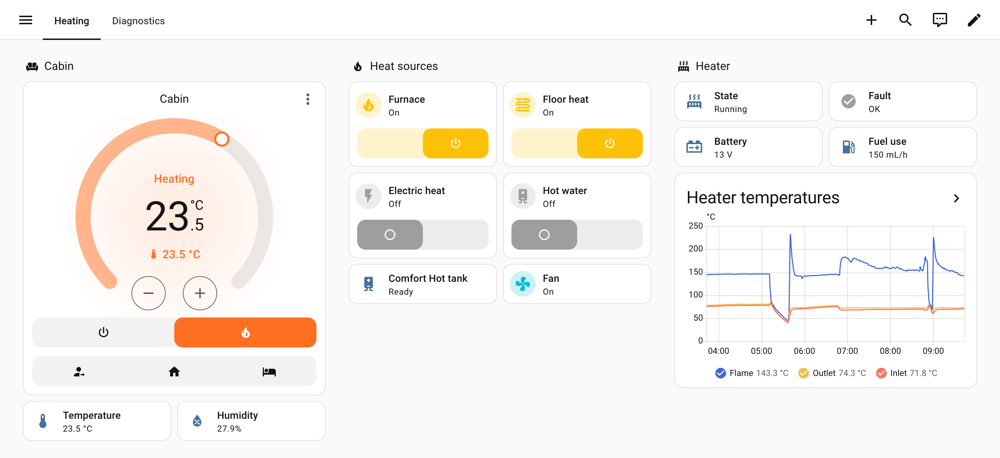
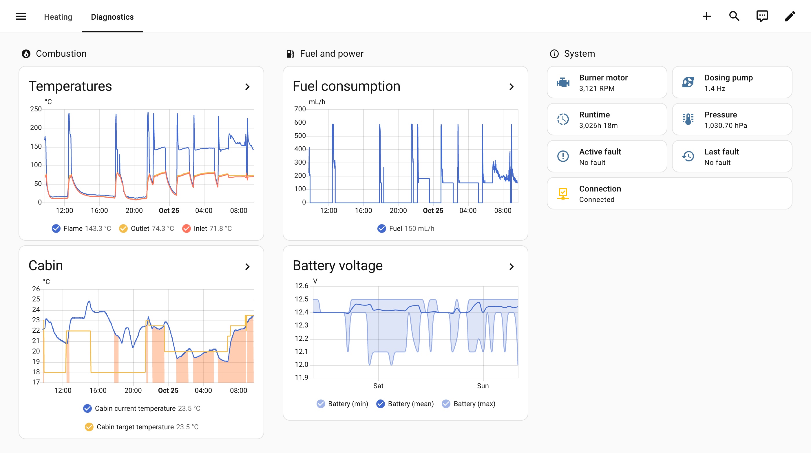
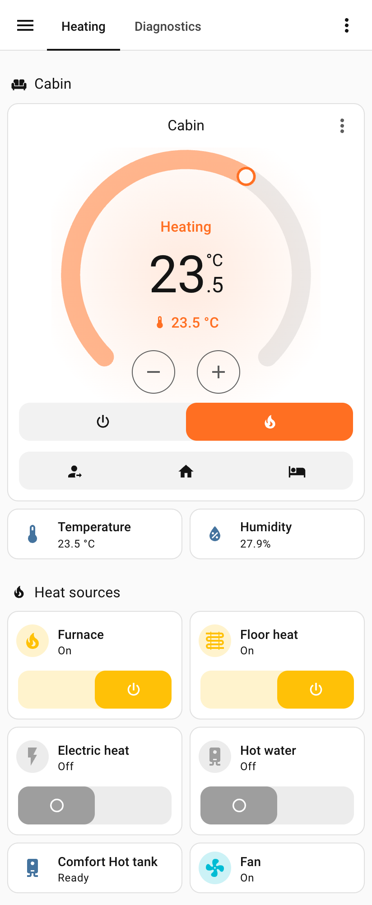

# Rixens Integration for Home Assistant

[](https://github.com/tailgatelabs/ha-rixens-integration/actions/workflows/validate.yml)
[](https://github.com/hacs/integration)
[](https://github.com/tailgatelabs/ha-rixens-integration/releases)
[](https://github.com/tailgatelabs/ha-rixens-integration/issues)

Control your Rixens heating system from your phone, tablet, or any Home
Assistant dashboard. Set temperatures, switch between heat sources, and get
alerts — all without walking to the thermostat.

<picture>
  <source media="(prefers-color-scheme: dark)" srcset="docs/images/controls-dark.png">
  
</picture>

## What You Need

- A **Rixens heating system** connected to your local WiFi network (a beta
  firmware may be required)
- **Home Assistant** (2024.11 or later)
- **HACS** installed
  ([how to install HACS](https://hacs.xyz/docs/use/download/download/))

## Installation

### HACS (Recommended)

1. Open **HACS**, then the three-dot menu (top right) > **Custom repositories**
2. Paste: `https://github.com/tailgatelabs/ha-rixens-integration`
3. Select **Integration** as the type, then click **Add**
4. Search HACS for "Rixens", open it and click **Download**
5. **Restart Home Assistant**
6. Go to **Settings** > **Devices & Services** > **Add Integration** > search
   "Rixens"
7. Enter your device's IP address (leave the port at 80 unless you changed it) —
   done!

### Manual Installation

1. Download the latest release from the
   [releases page](https://github.com/tailgatelabs/ha-rixens-integration/releases)
2. Copy the `custom_components/rixens` folder into your Home Assistant
   `custom_components` directory
3. Restart Home Assistant
4. Add the integration via **Settings** > **Devices & Services** > **Add
   Integration** > search "Rixens"

## Features

Once installed, you get full control of your Rixens heater right from Home
Assistant:

| What you can do                       | How                                                              |
| ------------------------------------- | ---------------------------------------------------------------- |
| Set your desired temperature (5-35°C) | Climate card or thermostat entity                                |
| Turn the heater on or off             | Climate card power button                                        |
| Switch between heat sources           | Furnace, Electric Heat, and Floor Heat switches                  |
| Turn on hot water                     | Hot Water switch                                                 |
| Control the fan                       | Auto mode or manual speed (10-100%)                              |
| Use quick temperature presets         | Away (freeze protection), Home, or Sleep                         |
| Monitor room conditions               | Temperature and humidity sensors                                 |
| See if hot water is ready             | Comfort Hot tank sensor (Not ready, Ready, Hot)                  |
| Track heater diagnostics              | Battery voltage, flame temp, fuel consumption, runtime, and more |
| See how much fuel the furnace burns   | Fuel used sensor (running total, by day, week or month)          |
| Check connectivity                    | Connection status binary sensor                                  |
| Get alerted to heater faults          | Heater fault problem sensor and fault-detected event             |

The integration follows Rixen's official
[MCS Local API documentation](https://documenter.getpostman.com/view/55318949/2sBXwnsBuf).

All temperature values automatically display in your preferred units (Celsius or
Fahrenheit) based on your Home Assistant settings.

### Keep an eye on the heater

Flame, inlet and outlet temperatures, fuel use, battery voltage and fault codes
are all recorded, so you can spot problems before they leave you cold.

<picture>
  <source media="(prefers-color-scheme: dark)" srcset="docs/images/diagnostics-dark.png">
  
</picture>

### Track fuel use

The **Fuel used** sensor keeps a running total of the fuel the furnace has
burned, and carries on across restarts. It's in litres by default; to show
gallons, open the sensor's settings and change its unit.

To chart fuel burned per day, add a **Statistics graph** card with the Fuel used
sensor, **Stat type** set to **Change** and **Period** set to **Day** (or Week
or Month).

<!-- FUEL_USED_SCREENSHOT -->

The total is only as accurate as the [fuel dose setting](#setting-up-presets),
and counting starts when you install this version. If the heater is unreachable
for more than a minute, that time isn't counted.

### Control it from your phone

Everything works in the Home Assistant companion app, including away from the RV
if you have remote access set up.

<picture>
  <source media="(prefers-color-scheme: dark)" srcset="docs/images/mobile-dark.png">
  
</picture>

## Setting Up Presets

Customize the preset temperatures to match your comfort preferences:

1. Go to **Settings** > **Devices & Services**
2. Find the **Rixens** integration and click **Configure**
3. Adjust the preset temperatures (5-30°C):
   - **Away** — Freeze protection (default: 10°C)
   - **Home** — Comfortable living (default: 20°C)
   - **Sleep** — Night time (default: 18°C)
4. Click **Submit** — the integration reloads with the new values, no restart
   needed

A preset only changes the target temperature. If the heater is off, turn it on
as well (see [Pre-Heat Before You Arrive](#pre-heat-before-you-arrive)).

The same screen has a **Fuel dose per pump cycle** setting used to calculate
fuel consumption from the dosing pump rate. Leave the default (about 0.03 mL)
unless the reported fuel use doesn't match what you actually burn.

## Automation Ideas

Home Assistant lets you automate your heating based on schedules, location,
sensors, and more. You can create automations using the visual editor in
**Settings** > **Automations & Scenes** — no YAML required. Below are a few
ideas with YAML examples for reference.

The examples use the default entity IDs (`climate.rixens_heater`,
`sensor.rixens_heater_battery_voltage`, …). If you renamed the device or
entities, use your own IDs.

### Freeze Protection When You Leave

Automatically set Away mode when you've been gone for 30 minutes, keeping your
RV above freezing without wasting fuel.

```yaml
automation:
  - alias: "RV Freeze Protection"
    triggers:
      - trigger: state
        entity_id: person.your_name
        from: "home"
        for: "00:30:00"
    actions:
      - action: climate.set_hvac_mode
        target:
          entity_id: climate.rixens_heater
        data:
          hvac_mode: "heat"
      - action: climate.set_preset_mode
        target:
          entity_id: climate.rixens_heater
        data:
          preset_mode: "away"
```

### Low Battery Alert

Get a phone notification when your RV battery drops below 12V so you can plug in
before it's too late.

```yaml
automation:
  - alias: "RV Low Battery Alert"
    triggers:
      - trigger: numeric_state
        entity_id: sensor.rixens_heater_battery_voltage
        below: 12.0
    actions:
      - action: notify.mobile_app_your_phone # Your phone's notify action
        data:
          title: "Low RV Battery"
          message: >-
            Battery voltage is {{ states('sensor.rixens_heater_battery_voltage')
            }} V
```

### Switch to Electric Heat on Shore Power

Save fuel by automatically switching to electric heat when you plug into shore
power.

```yaml
automation:
  - alias: "Use Electric Heat on Shore Power"
    triggers:
      - trigger: state
        entity_id: binary_sensor.shore_power # Your shore power sensor
        to: "on"
    conditions:
      - condition: state
        entity_id: climate.rixens_heater
        state: "heat"
    actions:
      - action: switch.turn_off
        target:
          entity_id: switch.rixens_heater_furnace
      - action: switch.turn_on
        target:
          entity_id: switch.rixens_heater_electric_heat
```

### Pre-Heat Before You Arrive

Use geofencing to start heating your RV as you approach — walk into a warm
space.

```yaml
automation:
  - alias: "Pre-Heat RV on Approach"
    triggers:
      - trigger: zone
        entity_id: person.your_name
        zone: zone.rv_location
        event: enter
    actions:
      - action: climate.set_hvac_mode
        target:
          entity_id: climate.rixens_heater
        data:
          hvac_mode: "heat"
      - action: climate.set_preset_mode
        target:
          entity_id: climate.rixens_heater
        data:
          preset_mode: "home"
```

## Troubleshooting

### Device not responding?

- Make sure the heater is powered on and connected to WiFi
- Try visiting `http://<your-device-ip>/status.xml` in a browser — you should
  see XML data
- Make sure Home Assistant and the Rixens device are on the same network

### Sensors showing "Unavailable"?

- Check the **Connection** binary sensor
  (`binary_sensor.rixens_heater_connection`) to see if the device is reachable
- The integration automatically retries failed connections and keeps the last
  known data for about 50 seconds during brief network hiccups
- If sensors stay unavailable, check your Home Assistant logs for error details
- Temperature and humidity show **Unknown** when no cabin sensor is connected to
  the controller

### Updates seem slow?

- The integration polls your device every 5 seconds
- Slow updates usually indicate network latency — check your WiFi signal at the
  device

### Still stuck?

- Search existing
  [issues](https://github.com/tailgatelabs/ha-rixens-integration/issues) —
  someone may have had the same problem
- Open a
  [new issue](https://github.com/tailgatelabs/ha-rixens-integration/issues/new)
  with your Home Assistant version, integration version, and relevant logs

## Contributing

Contributions are welcome! See [DEVELOPER.md](DEVELOPER.md) for project
architecture, entity details, and development guidelines. For major changes,
please open an issue first to discuss.

## Changelog

See [CHANGELOG.md](CHANGELOG.md) for a detailed list of changes in each version.

## License

This project is licensed under the MIT License — see the [LICENSE](LICENSE) file
for details.

## Acknowledgments

- Built with [Home Assistant](https://www.home-assistant.io/)
- Developed with assistance from [Claude Code](https://claude.ai/code)

---

**Disclaimer**: This is a community-developed integration and is not officially
affiliated with or endorsed by Rixens. Use at your own risk.
